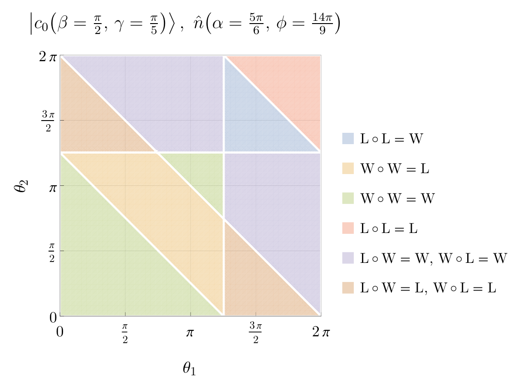
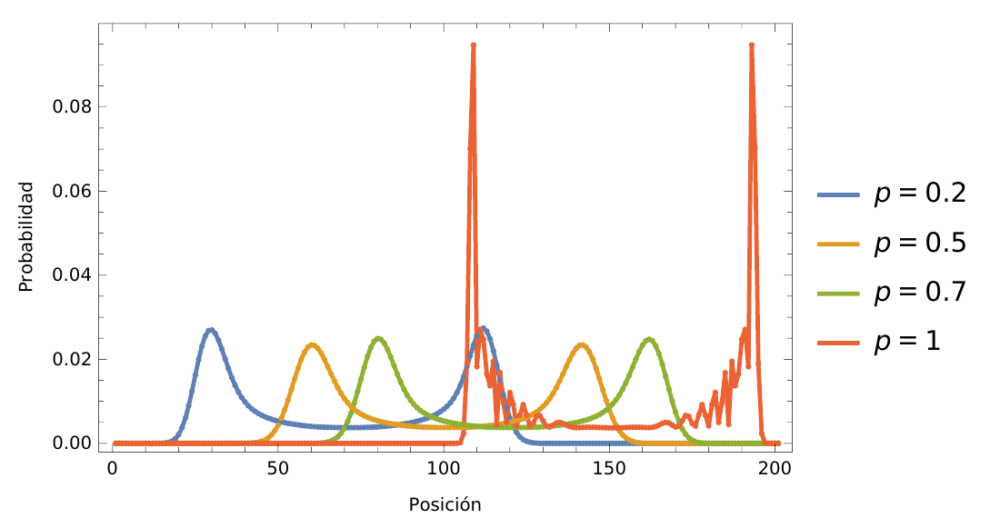
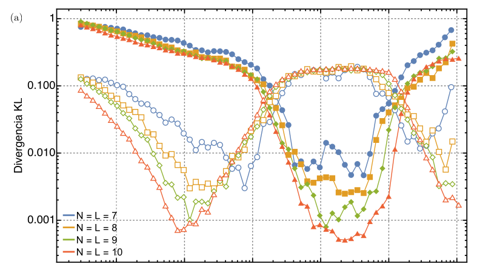
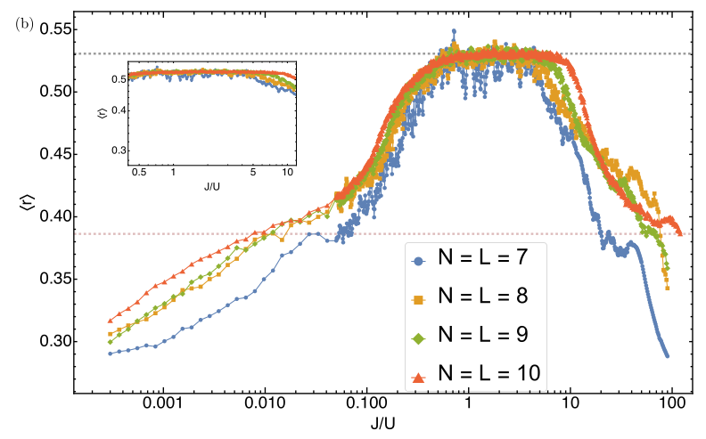

# Proyectos asesorados

Hacia el final de mi maestría en la UNAM, en México, quise explorar mis ideas de investigación mediante colaboraciones y, al mismo tiempo, contribuir a mi alma mater, la Universidad de San Carlos de Guatemala. Por ello, comencé a buscar estudiantes de licenciatura interesados en trabajar conmigo en estos temas. Me alegra que una de estas colaboraciones haya dado lugar a un artículo de investigación.

Si sos estudiante de licenciatura y te interesan mis temas de investigación o te gustaría explorar la posibilidad de trabajar conmigo, no dudés en escribirme a <deleongarrido.jose@gmail.com>.

## Proyectos de graduación de licenciatura

1. **Saúl Najera** (ECFM-USAC)
Septiembre de 2026 -- actualidad 
*Caminatas cuánticas de tiempo discreto en billares*  
Análisis de la emergencia del caos cuántico de un caminante cuántico en geometrías de billares, como el rectángulo y el billar de Sinaí.

2. **Mariana Pérez Muralles**[^1] (ECFM-USAC)
Marzo de 2025 -- agosto de 2026 
*Paradoja de Parrondo en caminatas cuánticas de tiempo discreto* \
Investigación sobre la aparición de la paradoja de Parrondo en caminatas cuánticas unidimensionales de tiempo discreto con operadores de moneda homogéneos. \
\
Este proyecto incluye la coorganización de un curso introductorio práctico de una semana sobre Wolfram Mathematica ([sitio del curso](https://www.notion.so/amadocab/De-ecuaciones-a-c-digo-22a6c4e3f1c880a8a7cace2255612b35)).
[[Tesis](/files/tesis_mariana.pdf)]

   <figure>
     
     <figcaption style="color: var(--global-text-color); font-size: 0.9em;">Diagrama de fase de la emergencia de la paradoja de Parrondo (región azul) en caminatas cuánticas de tiempo discreto. Para más detalles, consulta la <a href="/files/tesis_mariana.pdf">tesis de Mariana</a>.</figcaption>
   </figure>

3. **Amado Cabrera Estrada**[^1] (ECFM-USAC)
Marzo de 2025 -- agosto de 2026 
*Mediciones imperfectas en caminatas cuánticas de tiempo discreto*  
Análisis de los efectos de aparatos de medición imperfectos en caminatas cuánticas unidimensionales de tiempo discreto, dentro del marco de canales cuánticos de las [mediciones difusas](https://arxiv.org/abs/2011.03145). \
\
Este proyecto incluye la coorganización de un curso introductorio práctico de una semana sobre Wolfram Mathematica ([sitio del curso](https://www.notion.so/amadocab/De-ecuaciones-a-c-digo-22a6c4e3f1c880a8a7cace2255612b35)).
[[Tesis](/files/tesis_amado.pdf)]

   <figure>
     
     <figcaption style="color: var(--global-text-color); font-size: 0.9em;">Efecto del canal fuzzy shift sobre la distribución de probabilidad de una caminata cuántica de tiempo discreto en una línea infinita tras 100 pasos, para distintos valores de la probabilidad de decoherencia. Para más detalles, consulta la <a href="/files/tesis_amado.pdf">tesis de Amado</a>.</figcaption>
   </figure>

[^1]: Codirigido con el Prof. Carlos Pineda.

## Proyectos finales de prácticas de licenciatura

1. **Dessiré Zapeta** (ECFM-USAC)
   Mayo de 2026 -- actualidad 
   *Caos cuántico en caminatas cuánticas:*  
   Investigación de las distribuciones de espaciamiento entre niveles de caminatas cuánticas de tiempo discreto en billares.

2. **Saúl Najera** (ECFM-USAC)
   Septiembre de 2025 -- mayo de 2026 
   *Caos cuántico en el modelo de Bose–Hubbard:*  
   Caracterización de la transición del régimen integrable al caótico en el modelo de Bose–Hubbard.  
   [[Informe final](/files/informe_practicas_saul.pdf)]

   <figure>
     

       
       
     

   

   <figcaption style="color: var(--global-text-color); font-size: 0.9em;">Transición del comportamiento integrable al caótico en el modelo de Bose–Hubbard. Los paneles muestran cómo cambian dos medidas de caos cuántico con la intensidad de la interacción. Para más detalles, consulta el <a href="/files/informe_practicas_saul.pdf">informe de Saúl</a>.</figcaption>
   </figure>

3. **Mariana Pérez Muralles** (ECFM-USAC)
   Agosto de 2023 -- noviembre de 2024 
   *Caminatas cuánticas de tiempo discreto:*  
   Marco teórico e implementación numérica de caminatas cuánticas de tiempo discreto.  
   [[Informe final](/files/informe_practicas_mariana.pdf)]

4. **Amado Cabrera Estrada** (ECFM-USAC)
   Agosto de 2023 -- noviembre de 2024 
   *Caminatas cuánticas de tiempo discreto:*  
   Marco teórico e implementación numérica de caminatas cuánticas de tiempo discreto.  
   Un paquete de Wolfram Language desarrollado por Amado durante este proyecto está disponible en
   [https://github.com/AmadoCab/QW](https://github.com/AmadoCab/QW).  
   [[Informe final](/files/informe_practicas_amado.pdf)]
