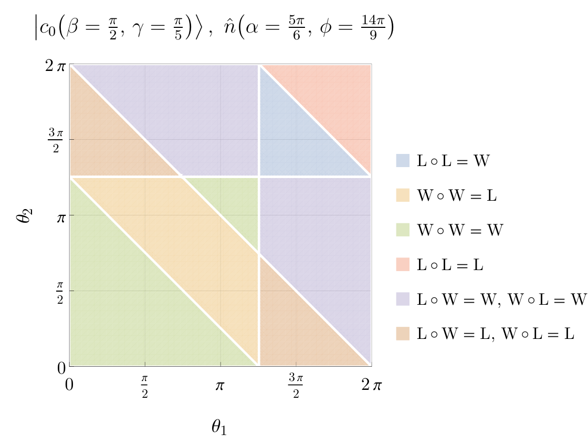
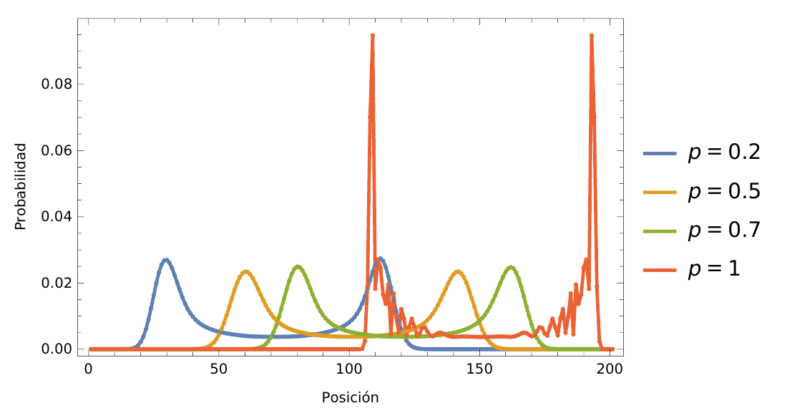
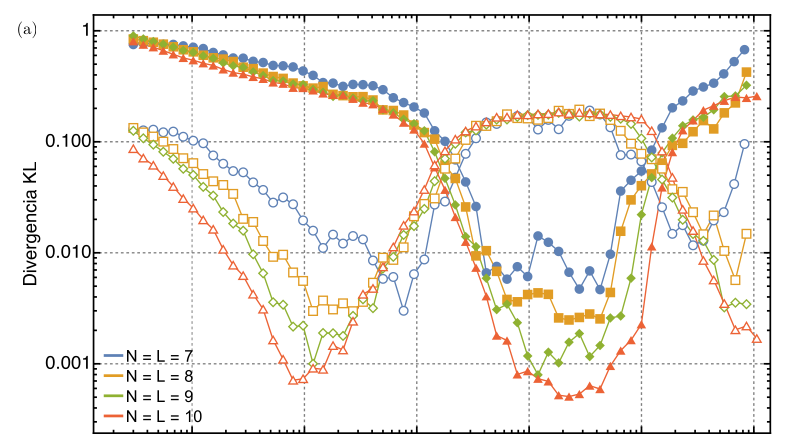
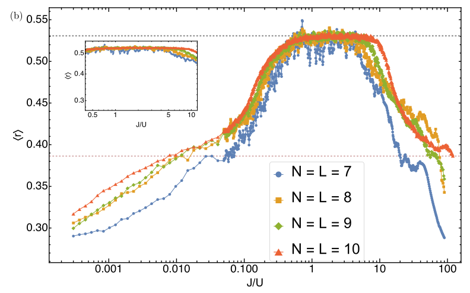

# Projects mentored
Toward the end of my master's degree at UNAM in Mexico, I wanted to
explore my research ideas through collaboration while also contributing
to my alma mater, Universidad de San Carlos de Guatemala. I therefore
began looking for undergraduate students there who were interested in
working with me on these topics. I am pleased that one of these
collaborations ultimately led to a research paper.

## Undergraduate graduation projects

1. **Saúl Najera** (ECFM-USAC)
September 2026 -- Present 
*Discrete-time quantum walks in billiards*  
Analysis of the emergence of quantum chaos for a quantum walker in billiard geometries, such as the rectangle and the Sinai billiard.

2. **Mariana Pérez Muralles**[^1] (ECFM-USAC) 
March 2025 -- August 2026 
*Parrondo's paradox in discrete-time quantum walks* \
Investigation of the emergence of Parrondo's paradox in 1D discrete-time quantum walks using homogeneous coin operators. \
\
This project includes the co-organization of a week-long hands-on introductory course on Wolfram Mathematica ([course website](https://www.notion.so/amadocab/De-ecuaciones-a-c-digo-22a6c4e3f1c880a8a7cace2255612b35)).
[[Thesis (in Spanish)](/files/tesis_mariana.pdf)]

   <figure>
     
     <figcaption style="color: var(--global-text-color); font-size: 0.9em;">Phase diagram for the emergence of Parrondo’s paradox (blue region) in discrete-time quantum walks. For details, see <a href="/files/tesis_mariana.pdf">Mariana’s thesis</a>.</figcaption>
   </figure>

3. **Amado Cabrera Estrada**[^1] (ECFM-USAC)
March 2025 -- August 2026 
*Imperfect measurements in discrete-time quantum walks*  
Analysis of the effects of imperfect measurement apparatus, within the quantum channel-based framework of [fuzzy measurements](https://arxiv.org/abs/2011.03145), on 1D discrete-time quantum walks. \
\
This project includes the co-organization of a week-long hands-on introductory course on Wolfram Mathematica ([course website](https://www.notion.so/amadocab/De-ecuaciones-a-c-digo-22a6c4e3f1c880a8a7cace2255612b35)).
[[Thesis (in Spanish)](/files/tesis_amado.pdf)]

   <figure>
     
     <figcaption style="color: var(--global-text-color); font-size: 0.9em;">Effect of the fuzzy shift channel on the probability distribution of a discrete-time quantum walk on an infinite line after 100 steps, for different values of the decoherence probability. For details, see <a href="/files/tesis_amado.pdf">Amado’s thesis</a>.</figcaption>
   </figure>

[^1]: Co-advised with Prof. Carlos Pineda.

## Undergraduate final internship projects

1. **Dessiré Zapeta** (ECFM-USAC)
   May 2026 -- Present 
   *Quantum chaos in quantum walks:*  
   Investigation of the level spacing distributions of discrete-time quantum walks in billiards.

2. **Saúl Najera** (ECFM-USAC)
   September 2025 -- May 2026 
   *Quantum chaos in the Bose–Hubbard model:*  
   Characterization of the integrable-to-chaos transition in the Bose–Hubbard model.  
   [[Final report (in Spanish)](/files/informe_practicas_saul.pdf)]

   <figure>
     

       
       
     

   

   <figcaption style="color: var(--global-text-color); font-size: 0.9em;">Transition from integrable to chaotic behavior in the Bose–Hubbard model. The panels show how two measures of quantum chaos change with the interaction strength. For details, see <a href="/files/informe_practicas_saul.pdf">Saúl’s report</a>.</figcaption>
   </figure>

3. **Mariana Pérez Muralles** (ECFM-USAC)
   August 2023 -- November 2024 
   *Discrete-time quantum walks:*  
   Theoretical framework and numerical implementation of discrete-time quantum walks.  
   [[Final report (in Spanish)](/files/informe_practicas_mariana.pdf)]

4. **Amado Cabrera Estrada** (ECFM-USAC)
   August 2023 -- November 2024 
   *Discrete-time quantum walks:*  
   Theoretical framework and numerical implementation of discrete-time quantum walks.  
   A Wolfram Language package developed by Amado during this project is available at
   [https://github.com/AmadoCab/QW](https://github.com/AmadoCab/QW).  
   [[Final report (in Spanish)](/files/informe_practicas_amado.pdf)]
